# Nicabliss API - Hotel Management System (PMS Backend)

Backend RESTful empresarial de alto rendimiento para el sistema de gestion hotelera Nicabliss, construido con Node.js, Express, TypeScript en modo estricto, seguridad JWT, hashing con Bcrypt, persistencia relacional distribuida en el Edge con **Turso Web (LibSQL / SQLite)** y una arquitectura en capas limpia, modular y desacoplada.

---

## Tabla de Contenidos

1. [Vision General del Sistema](#vision-general-del-sistema)
2. [Stack Tecnologico y Dependencias](#stack-tecnologico-y-dependencias)
3. [Estructura del Proyecto y Arquitectura](#estructura-del-proyecto-y-arquitectura)
4. [Instalacion y Puesta en Marcha](#instalacion-y-puesta-en-marcha)
5. [Variables de Entorno](#variables-de-entorno)
6. [Credenciales y Datos de Prueba](#credenciales-y-datos-de-prueba)
7. [Documentacion Tecnica de la API (Endpoints)](#documentacion-tecnica-de-la-api-endpoints)
   - [Salud del Sistema](#1-salud-del-sistema)
   - [Autenticacion y Usuarios](#2-autenticacion-y-usuarios-apiv1auth)
   - [Dashboard y Metricas](#3-dashboard-y-metricas-apiv1dashboard)
   - [Huespedes y Estancias](#4-huespedes-y-estancias-apiv1guests)
   - [Cuentas y Cobros](#5-cuentas-y-cobros-apiv1billing)
   - [Pedidos de Alimentos](#6-pedidos-de-alimentos-apiv1food-orders)
   - [Lavanderia](#7-lavanderia-apiv1laundry)
   - [Caja y Cierres](#8-caja-y-cierres-apiv1cash-register)
8. [Suite de Pruebas Automatizadas (QA)](#suite-de-pruebas-automatizadas-qa)
9. [Seguridad y Politicas](#seguridad-y-politicas)
10. [Base de Datos Turso Web (LibSQL) y Diagrama ER](#base-de-datos-turso-web-libsql-y-diagrama-er)

---

## Vision General del Sistema

Nicabliss API centraliza y automatiza todas las operaciones diarias de un hotel moderno:
- Recepcion: Registro de huespedes, check-in, check-out y validacion de consistencia de fechas.
- Cuentas y Facturacion: Cargos por habitacion, abonos parciales, liquidacion total y calculo dinamico de saldos.
- Cocina y Room Service: Comandas de alimentos, calculo de importes y ciclo de preparacion.
- Lavanderia: Conteo por tipo de prenda, tarifa unitaria automatica ($0.50) y seguimiento de entrega.
- Caja Chica y Turnos: Apertura de caja con fondo inicial, control de ingresos/egresos, arqueo de efectivo con calculo de diferencia (sobrante/faltante) y cierre de turno.
- Dashboard en Tiempo Real: Agregacion instantanea de ingresos del dia, pedidos pendientes y ocupacion.

---

## Stack Tecnologico y Dependencias

| Tecnologia / Libreria | Version | Proposito en el Proyecto |
| :--- | :--- | :--- |
| Node.js | >= 20.x (Probado en v24.19.0) | Entorno de ejecucion en servidor. |
| TypeScript | ^5.8.2 | Tipado estatico estricto, interfaces y validacion en tiempo de compilacion. |
| Express | ^4.21.2 | Framework HTTP rapido y minimalista para el diseno de APIs RESTful. |
| jsonwebtoken | ^9.0.2 | Generacion y verificacion de tokens Bearer firmados criptograficamente. |
| bcryptjs | ^3.0.3 | Hashing seguro de contrasenas con factor de coste de 10 salt rounds. |
| helmet | ^8.0.0 | Configuracion segura de cabeceras HTTP (CSP, noSniff, xssFilter). |
| cors | ^2.8.5 | Control de acceso HTTP entre origenes (Frontend localhost:5173). |
| dotenv | ^16.4.7 | Inyeccion y tipado de variables de entorno desde archivos .env. |
| @libsql/client | ^0.18.0 | Cliente oficial de Turso para conexiones LibSQL/SQLite en el Edge sin binarios C++. |
| tsx | ^4.19.3 | Ejecucion directa de TypeScript en desarrollo y runner de pruebas ultrarrapido. |

---

## Estructura del Proyecto y Arquitectura

El proyecto esta disenado bajo una Arquitectura en Capas Limpias (Layered Architecture) para garantizar separacion de responsabilidades y maxima facilidad de lectura:

```text
nicabliss_api/
|-- .env                         # Variables de entorno activas (ignorado por git)
|-- .env.example                 # Plantilla de variables de entorno para despliegue
|-- .gitignore                   # Reglas de exclusion para git (node_modules, dist, .env)
|-- package.json                 # Definicion de dependencias, metadatos y scripts
|-- tsconfig.json                # Configuracion estricta de TypeScript (ES2022 / NodeNext)
|-- README.md                    # Documentacion tecnica completa
|-- dist/                        # Codigo JavaScript compilado para produccion
|-- tests/                       # Suite de pruebas automatizadas (QA)
|   |-- unit/                    # Pruebas unitarias de servicios y modelos de negocio
|   |   |-- auth.service.test.ts
|   |   |-- guest.service.test.ts
|   |   |-- billing.service.test.ts
|   |   |-- food-order.service.test.ts
|   |   |-- laundry.service.test.ts
|   |   |-- cash.service.test.ts
|   |   `-- dashboard.service.test.ts
|   `-- integration/             # Pruebas de integracion de la API HTTP (E2E)
|       `-- api.test.ts
`-- src/
    |-- config/                  # Configuracion del entorno (env.ts con soporte Turso)
    |-- db/                      # Capa de base de datos Turso LibSQL
    |   |-- client.ts            # Cliente singleton de conexion a Turso (@libsql/client)
    |   |-- schema.sql           # Definicion DDL relacional, constraints e indices
    |   |-- migrate.ts           # Ejecutor automatizado de migraciones DDL
    |   `-- seed.ts              # Semillero con datos iniciales (admin, huespedes, turnos)
    |-- models/                  # Modelos de datos del dominio y tipos de entidades
    |   |-- user.model.ts        # Usuario, credenciales y roles
    |   |-- guest.model.ts       # Huesped y estancias
    |   |-- billing.model.ts     # Cuentas, totales y estados de cobro
    |   |-- food-order.model.ts  # Ordenes de alimentos
    |   |-- laundry.model.ts     # Solicitudes de lavanderia y catalogo de prendas
    |   `-- cash.model.ts        # Turnos de caja y movimientos
    |-- dtos/                    # Contratos de Datos (Data Transfer Objects)
    |   |-- auth.dto.ts
    |   |-- guest.dto.ts
    |   |-- billing.dto.ts
    |   |-- food-order.dto.ts
    |   |-- laundry.dto.ts
    |   `-- cash.dto.ts
    |-- repositories/            # Capa de Persistencia Relacional en Turso (LibSQL)
    |   |-- user.repository.ts
    |   |-- guest.repository.ts
    |   |-- billing.repository.ts
    |   |-- food-order.repository.ts
    |   |-- laundry.repository.ts
    |   `-- cash.repository.ts
    |-- services/                # Logica de negocio, reglas y validaciones
    |   |-- auth.service.ts
    |   |-- guest.service.ts
    |   |-- billing.service.ts
    |   |-- food-order.service.ts
    |   |-- laundry.service.ts
    |   |-- cash.service.ts
    |   `-- dashboard.service.ts
    |-- controllers/             # Manejadores de peticion (Request) y respuesta (Response)
    |   |-- auth.controller.ts
    |   |-- guest.controller.ts
    |   |-- billing.controller.ts
    |   |-- food-order.controller.ts
    |   |-- laundry.controller.ts
    |   |-- cash.controller.ts
    |   `-- dashboard.controller.ts
    |-- routes/                  # Definicion de rutas y endpoints Express
    |   |-- auth.routes.ts
    |   |-- guest.routes.ts
    |   |-- billing.routes.ts
    |   |-- food-order.routes.ts
    |   |-- laundry.routes.ts
    |   |-- cash.routes.ts
    |   |-- dashboard.routes.ts
    |   `-- index.ts             # Enrutador centralizado montado en /api/v1
    |-- middlewares/             # Filtros de seguridad y manejo global
    |   |-- auth.middleware.ts   # Validacion de Bearer Token JWT
    |   |-- role.middleware.ts   # Autorizacion RBAC (ADMIN, RECEPTIONIST)
    |   |-- error.middleware.ts  # Capturador central de excepciones con codigos HTTP
    |   `-- logger.middleware.ts # Registro en consola de tiempo y status de peticiones
    |-- utils/                   # Utilidades transversales
    |   |-- hasher.ts            # Hashing con Bcrypt (hash y hashSync)
    |   |-- jwt.ts               # Firma y verificacion de tokens
    |   `-- logger.ts            # Formateador de consola con timestamp
    |-- app.ts                   # Ensamblador de la aplicacion Express
    `-- server.ts                # Inicializacion en puerto 4000 y Graceful Shutdown
```

---

## Instalacion y Puesta en Marcha

### Prerrequisitos
- Node.js version 20 o superior.
- npm version 9 o superior.

### 1. Acceder al directorio
```bash
cd C:\Users\joshu\Downloads\nicabliss_api
```

### 2. Instalar dependencias
```bash
npm install
```

### 3. Configurar variables de entorno
El proyecto incluye un archivo .env preconfigurado. Si deseas crear uno nuevo:
```bash
cp .env.example .env
```

### 4. Ejecutar en Modo Desarrollo (Hot Reload)
Inicia la API con recarga en caliente utilizando tsx:
```bash
npm run dev
```

### 5. Compilar y Ejecutar en Modo Produccion
Compila el codigo TypeScript a JavaScript optimizado en dist/:
```bash
npm run build
npm start
```

---

## Variables de Entorno

Archivo .env:

| Variable | Tipo | Valor Predeterminado | Descripcion |
| :--- | :--- | :--- | :--- |
| PORT | Numero | 4000 | Puerto TCP en el que escuchara el servidor Express. |
| NODE_ENV | String | development | Entorno de ejecucion (development / production). |
| JWT_SECRET | String | Clave secreta | Clave simetrica utilizada para firmar los tokens JWT. |
| JWT_EXPIRES_IN | String | 8h | Tiempo de vida de los tokens de sesion. |
| CORS_ORIGIN | String | http://localhost:5173 | Origenes permitidos separados por comas para el Frontend. |
| TURSO_DATABASE_URL | String | libsql://...turso.io | URL de conexion a la base de datos distribuida en Turso. |
| TURSO_AUTH_TOKEN | String | Token JWT firmado | Token de autenticacion con permisos rw para Turso Cloud. |

---

## Credenciales y Datos de Prueba

La API se inicializa en memoria con un usuario administrador precargado con contrasena hasheada:

- Usuario: admin
- Contrasena: 12345
- Rol: ADMIN

---

## Documentacion Tecnica de la API (Endpoints)

Todas las rutas (excepto /health y /api/v1/auth/login) requieren la cabecera HTTP:
```http
Authorization: Bearer <TU_TOKEN_JWT>
```

### Formato Estandar de Respuesta
Todas las respuestas de la API siguen un formato predecible:

Exito:
```json
{
  "success": true,
  "data": { ... }
}
```

Error:
```json
{
  "success": false,
  "error": {
    "code": "VALIDATION_ERROR",
    "message": "Descripcion clara del error"
  },
  "timestamp": "2026-10-20T14:00:00.000Z"
}
```

---

### 1. Salud del Sistema

#### GET /health
Verifica que el servicio este activo.
- Acceso: Publico
- Respuesta (200 OK):
```json
{
  "status": "ok",
  "system": "Nicabliss Hotel Management API",
  "environment": "development",
  "timestamp": "2026-10-20T14:15:00.000Z"
}
```

---

### 2. Autenticacion y Usuarios (/api/v1/auth)

#### POST /api/v1/auth/login
Inicia sesion y obtiene un token JWT firmado.
- Acceso: Publico
- Body:
```json
{
  "usuario": "admin",
  "password": "12345"
}
```
- Respuesta (200 OK):
```json
{
  "success": true,
  "data": {
    "token": "eyJhbGciOiJIUzI1NiIsInR5cCI6IkpXVCJ9...",
    "user": {
      "id": "usr_admin_001",
      "username": "admin",
      "email": "admin@nicabliss.com",
      "fullName": "Administrador Nicabliss",
      "role": "ADMIN",
      "createdAt": "2026-10-20T08:00:00.000Z"
    }
  }
}
```

#### POST /api/v1/auth/register
Registra un nuevo usuario en el sistema.
- Acceso: Protegido (Requiere rol ADMIN)
- Body:
```json
{
  "username": "recepcion1",
  "email": "recepcion@nicabliss.com",
  "password": "Password123",
  "fullName": "Juan Recepcion",
  "role": "RECEPTIONIST"
}
```
- Respuesta (201 Created): Retorna el objeto del usuario creado sin la contrasena.

#### GET /api/v1/auth/me
Retorna los datos del usuario autenticado actual.
- Acceso: Protegido

---

### 3. Dashboard y Metricas (/api/v1/dashboard)

#### GET /api/v1/dashboard/metrics
Retorna las estadisticas agregadas del hotel en tiempo real.
- Acceso: Protegido
- Respuesta (200 OK):
```json
{
  "success": true,
  "data": {
    "stats": [
      { "label": "Ingresos del dia", "value": "$ 43.00", "detail": "Pagos registrados", "code": "revenue", "className": "stat-green" },
      { "label": "Cuentas abiertas", "value": "2", "detail": "Huespedes con saldo activo", "code": "accounts", "className": "stat-blue" },
      { "label": "Pedidos pendientes", "value": "2", "detail": "Solicitudes por atender", "code": "orders", "className": "stat-orange" },
      { "label": "Lavanderia pendiente", "value": "1", "detail": "Solicitudes en proceso", "code": "laundry", "className": "stat-purple" }
    ],
    "activeStays": 2,
    "cashRegisterActive": true,
    "recentTransactions": [ ... ]
  }
}
```

---

### 4. Huespedes y Estancias (/api/v1/guests)

#### GET /api/v1/guests
Lista los huespedes registrados. Soporta busqueda con ?search=.
- Query Params: ?search=carlos (opcional)
- Acceso: Protegido

#### GET /api/v1/guests/:id
Obtiene los detalles de un huesped especifico.

#### POST /api/v1/guests
Registra un nuevo huesped.
- Body:
```json
{
  "nombre": "Elena Rivas",
  "documento": "001-120499-0004D",
  "habitacion": "Habitacion 05",
  "entrada": "2026-10-21",
  "salida": "2026-10-24",
  "estado": "Activo"
}
```
- Regla de Negocio: Falla con 400 VALIDATION_ERROR si la fecha de salida es anterior a entrada.

#### PUT /api/v1/guests/:id
Actualiza los datos completos de un huesped (nombre, documento, habitacion, fechas o estado).
- Body:
```json
{
  "nombre": "Maria Gonzalez",
  "habitacion": "Habitacion 02",
  "salida": "2026-10-22"
}
```

#### PATCH /api/v1/guests/:id/status
Actualiza el estado de una estancia (Activo | Finalizado | Reservado).

#### DELETE /api/v1/guests/:id
Elimina el registro de un huesped del sistema.
- Respuesta (200 OK): `{ "success": true, "message": "Huesped con id 1 eliminado correctamente" }`

---

### 5. Cuentas y Cobros (/api/v1/billing)

#### GET /api/v1/billing
Obtiene todas las cuentas, el total facturado, cobrado y saldo global pendiente.
- Respuesta (200 OK):
```json
{
  "success": true,
  "cuentas": [ ... ],
  "resumen": {
    "totalFacturado": 60.5,
    "totalCobrado": 43.0,
    "saldoPendiente": 17.5
  }
}
```

#### POST /api/v1/billing
Crea una nueva cuenta o cargo para una habitacion.
- Body:
```json
{
  "huesped": "Elena Rivas",
  "habitacion": "Habitacion 05",
  "concepto": "Hospedaje 3 noches",
  "total": 120.0
}
```

#### PUT /api/v1/billing/:id
Actualiza los datos o el total de una cuenta de cobro, recalculando automaticamente el saldo y el estado.
- Body:
```json
{
  "concepto": "Estancia extendida a 4 noches",
  "total": 160.0
}
```
- Regla de Negocio: El total no puede ser inferior a los abonos ya registrados.

#### POST /api/v1/billing/:id/payments
Registra un abono a una cuenta existente.
- Body:
```json
{
  "monto": 50.0
}
```
- Regla de Negocio: Si el monto abonado completa la deuda, el estado cambia automaticamente a Pagado. Si es parcial, a Parcial. Rechaza con error 400 si el monto supera el saldo pendiente.

#### DELETE /api/v1/billing/:id
Elimina una cuenta de cobro pendiente.
- Regla Contable: Solo permite eliminar cuentas sin abonos o pagos registrados (`pagado === 0`). Si tiene pagos, rechaza con 400 VALIDATION_ERROR para proteger la auditoria fiscal.

---

### 6. Pedidos de Alimentos (/api/v1/food-orders)

#### GET /api/v1/food-orders
Lista los pedidos de restaurante/cocina.

#### POST /api/v1/food-orders
Crea una nueva comanda de alimentos.
- Body:
```json
{
  "huesped": "Maria Gonzalez",
  "habitacion": "Habitacion 01",
  "productos": "2 desayunos tipicos + 1 jugo de naranja",
  "total": 14.0
}
```
- Nota: Genera automaticamente un codigo de comanda correlativo unico (ej: #PED-582) con estado inicial Pendiente.

#### PUT /api/v1/food-orders/:id
Actualiza los productos, total o destino de la comanda.
- Body:
```json
{
  "productos": "2 desayunos tipicos + 2 jugos naturales",
  "total": 17.0
}
```

#### PATCH /api/v1/food-orders/:id/status
Actualiza el estado de la comanda (Pendiente | En preparacion | En camino | Entregado | Cancelado).

#### DELETE /api/v1/food-orders/:id
Elimina una comanda del sistema.

---

### 7. Lavanderia (/api/v1/laundry)

#### GET /api/v1/laundry
Lista las solicitudes de lavanderia.

#### POST /api/v1/laundry
Crea una nueva solicitud con desglose de prendas.
- Body:
```json
{
  "huesped": "Carlos Mendoza",
  "habitacion": "Habitacion 04",
  "prendas": [
    { "tipo": "Camisa", "cantidad": 3 },
    { "tipo": "Pantalon", "cantidad": 2 },
    { "tipo": "Toalla", "cantidad": 1 }
  ],
  "observaciones": "Planchar con almidon suave"
}
```
- Regla de Negocio: La API calcula automaticamente el total de prendas (6 prendas) y el importe exacto basado en la tarifa de $0.50 por prenda ($3.00 en total).

#### PUT /api/v1/laundry/:id
Actualiza la orden de lavanderia (prendas, observaciones o destino). Si se modifican las prendas, recalcula automaticamente el total y conteo a $0.50 por prenda.

#### PATCH /api/v1/laundry/:id/status
Actualiza el estado (Pendiente | En proceso | Listo | Entregado | Cancelado).

#### DELETE /api/v1/laundry/:id
Elimina una orden de lavanderia del sistema.

---

### 8. Caja y Cierres (/api/v1/cash-register)

#### GET /api/v1/cash-register/current
Consulta los datos de la sesion de caja activa actual. Retorna data: null si la caja esta cerrada.

#### POST /api/v1/cash-register/open
Abre un nuevo turno de caja con fondo inicial.
- Body:
```json
{
  "responsable": "Juan Recepcionista",
  "fondoInicial": 100.0
}
```
- Regla de Negocio: Impide abrir un nuevo turno si ya existe una sesion abierta (409 CONFLICT).

#### POST /api/v1/cash-register/movements
Registra un movimiento (ingreso o gasto operativo).
- Body:
```json
{
  "tipo": "Salida",
  "concepto": "Gasto operativo",
  "descripcion": "Compra de cafe y azucar para recepcion",
  "metodo": "Efectivo",
  "monto": 12.0
}
```
- Regla de Negocio: Impide que una salida en efectivo supere el monto disponible en caja (400 VALIDATION_ERROR).

#### POST /api/v1/cash-register/close
Realiza el arqueo y cierre del turno.
- Body:
```json
{
  "efectivoContado": 128.0,
  "observaciones": "Turno cerrado sin incidencias"
}
```
- Regla de Negocio: Calcula automaticamente la diferencia (efectivoContado - efectivoEsperado), archiva la sesion en el historial y libera la caja para el siguiente turno.

#### GET /api/v1/cash-register/history
Lista el historial de todos los cierres de caja realizados.

---

## Suite de Pruebas Automatizadas (QA)

El proyecto incluye **44 pruebas automatizadas** que garantizan que ningun cambio rompa la logica del negocio ni las operaciones CRUD:

Para correr las pruebas:
```bash
npm test
```

### Resumen de Pruebas:
- auth.service.test.ts (5 pruebas): Login exitoso, rechazo por contrasena erronea, rechazo por usuario inexistente, hasheo de contrasenas y deteccion de duplicados.
- guest.service.test.ts (7 pruebas): Listado, filtrado, creacion, validacion de fechas de salida, actualizacion de estancia, actualizacion completa (PUT) y eliminacion (DELETE).
- billing.service.test.ts (8 pruebas): Totales iniciales, creacion de cuenta, abono parcial, liquidacion total, rechazo de sobrepagos, actualizacion (PUT) con recalculo de saldos, proteccion contable contra borrado de cuentas con abonos y eliminacion limpia de cuentas sin abono (DELETE).
- food-order.service.test.ts (5 pruebas): Creacion con correlativo, ciclo de estados de comanda, edicion (PUT) y eliminacion (DELETE).
- laundry.service.test.ts (5 pruebas): Tarificacion automatica ($0.50/prenda), cambio de estado, rechazo de solicitudes sin prendas, edicion de lote con recalculo automatico (PUT) y eliminacion (DELETE).
- cash.service.test.ts (5 pruebas): Apertura, bloqueo de turnos dobles, movimientos, limite de egresos en efectivo, arqueo y diferencia de caja.
- dashboard.service.test.ts (1 prueba): Agregacion simultanea de metricas multi-repositorio.
- api.test.ts (8 pruebas E2E): Health check, login HTTP, rechazo de rutas sin token, acceso con Bearer token, listado de huespedes, actualizacion HTTP (PUT), eliminacion HTTP (DELETE) y respuestas semanticas 404.

---

## Seguridad y Politicas

1. Proteccion de Contrasenas: Se utiliza Bcrypt con 10 rondas de salting. Ninguna contrasena se guarda en texto plano ni se expone en las respuestas JSON.
2. Autenticacion sin Estado (Stateless): Los tokens JWT contienen firma HMAC-SHA256 y expiran en 8 horas por defecto.
3. Cabeceras HTTP Defensivas: Helmet elimina cabeceras como X-Powered-By y aplica politicas restrictivas contra ataques XSS y Clickjacking.
4. Control CORS Estricto: Solo las URLs definidas en CORS_ORIGIN tienen permitido comunicarse con la API desde el navegador.

---

## Base de Datos Turso Web (LibSQL) y Diagrama ER

La persistencia de **Nicabliss API** esta respaldada por **Turso Web**, un motor de base de datos relacional distribuido en el Edge basado en **LibSQL** (fork moderno y optimizado de SQLite).

### 1. Diagrama Entidad-Relacion (ER Diagram)

```mermaid
erDiagram
    USERS {
        TEXT id PK "Identificador único (usr_admin_001 o UUID)"
        TEXT username UK "Nombre de usuario único para login"
        TEXT email UK "Correo electrónico corporativo único"
        TEXT password_hash "Hash bcrypt (10 salt rounds)"
        TEXT role "Rol RBAC: ADMIN, RECEPTIONIST, STAFF"
        TEXT full_name "Nombre completo del usuario"
        TEXT created_at "Timestamp ISO 8601 UTC"
    }

    GUESTS {
        INTEGER id PK "Autoincremental"
        TEXT nombre "Nombre completo del huésped titular"
        TEXT documento "Cédula o pasaporte"
        TEXT habitacion "Habitación asignada (ej. Habitación 01)"
        TEXT entrada "Fecha check-in (YYYY-MM-DD)"
        TEXT salida "Fecha check-out (YYYY-MM-DD)"
        TEXT estado "Estado: Activo, Finalizado, Reservado"
        TEXT created_at "Timestamp de creación"
    }

    BILLING_ACCOUNTS {
        INTEGER id PK "Identificador numérico de cuenta"
        INTEGER guest_id FK "Vínculo suave opcional (SET NULL)"
        TEXT huesped "Snapshot inmutable del huésped"
        TEXT habitacion "Snapshot de habitación asignada"
        TEXT concepto "Concepto de cargo (Hospedaje, etc.)"
        REAL total "Importe total (> 0)"
        REAL pagado "Monto abonado (>= 0)"
        REAL saldo "Saldo pendiente (total - pagado)"
        TEXT estado "Estado: Pendiente, Parcial, Pagado"
        TEXT fecha "Fecha de facturación (YYYY-MM-DD)"
    }

    FOOD_ORDERS {
        INTEGER id PK "Identificador numérico de comanda"
        TEXT order_code UK "Código amigable único (#PED-xxx)"
        INTEGER guest_id FK "Vínculo suave opcional (SET NULL)"
        TEXT huesped "Nombre del comensal o huésped"
        TEXT habitacion "Habitación o destino de entrega"
        TEXT productos "Detalle de platillos y bebidas"
        REAL total "Importe total de comanda"
        TEXT estado "Pendiente, En preparación, En camino, Entregado, Cancelado"
        TEXT fecha "Fecha de la orden"
    }

    LAUNDRY_ORDERS {
        INTEGER id PK "Identificador numérico de orden"
        INTEGER guest_id FK "Vínculo suave opcional (SET NULL)"
        TEXT huesped "Nombre del huésped solicitante"
        TEXT habitacion "Habitación de entrega"
        TEXT prendas "Array JSON con desglose de prendas"
        INTEGER total_prendas "Conteo de prendas (> 0)"
        REAL total "Costo total a $0.50 por prenda"
        TEXT estado "Pendiente, En proceso, Listo, Entregado, Cancelado"
        TEXT fecha "Fecha de recepción"
        TEXT observaciones "Instrucciones de planchado/cuidado"
    }

    CASH_SESSIONS {
        INTEGER id PK "Identificador de turno de caja"
        TEXT responsable "Usuario a cargo del turno"
        TEXT apertura "Fecha y hora de inicio"
        TEXT cierre "Fecha y hora de cierre (NULL si abierto)"
        REAL fondo_inicial "Fondo base en efectivo (>= 0)"
        REAL ingresos_efectivo "Total cobrado en efectivo"
        REAL ingresos_digitales "Total cobrado en tarjeta/transferencia"
        REAL salidas_efectivo "Total de egresos/gastos en efectivo"
        REAL efectivo_esperado "Balance teórico calculado"
        REAL efectivo_contado "Efectivo físico contado en arqueo"
        REAL diferencia "Descuadre (efectivoContado - efectivoEsperado)"
        TEXT observaciones "Notas del cierre"
        INTEGER is_closed "0: Turno Activo | 1: Turno Cerrado"
    }

    CASH_MOVEMENTS {
        INTEGER id PK "Identificador de movimiento"
        INTEGER session_id FK "Turno asociado (CASCADE)"
        TEXT fecha "Fecha y hora del movimiento"
        TEXT tipo "Ingreso o Salida"
        TEXT concepto "Hospedaje, Alimentos, Lavandería, Gasto, etc."
        TEXT descripcion "Detalle del movimiento"
        TEXT metodo "Efectivo, Transferencia o Tarjeta"
        REAL monto "Importe del movimiento (> 0)"
    }

    CASH_SESSIONS ||--|{ CASH_MOVEMENTS : "1:N Estricta (ON DELETE CASCADE)"
    GUESTS ||--o{ BILLING_ACCOUNTS : "1:N Híbrida (SET NULL + Snapshot)"
    GUESTS ||--o{ FOOD_ORDERS : "1:N Híbrida (SET NULL + Snapshot)"
    GUESTS ||--o{ LAUNDRY_ORDERS : "1:N Híbrida (SET NULL + Snapshot)"
```



---

### 2. Arquitectura de Conexiones e Integridad

- **Conexion Segura LibSQL:** `@libsql/client` gestiona peticiones HTTP/WebSocket seguras hacia el cluster de Turso (`libsql://...`), ofreciendo tiempos de respuesta en microsegundos sin requerir compiladores C++ nativos.
- **Relaciones Fuertes (CASCADE):** Cada registro en `cash_movements` pertenece estrictamente a una sesion de `cash_sessions`.
- **Patron Snapshot Contable (Inmutabilidad):** Las cuentas de cobro, comandas y lavanderia conservan `huesped` y `habitacion` como copia fija, de forma que el historial fiscal permanece inalterable aunque un huesped finalice su estancia (`ON DELETE SET NULL`).
- **Indice Unico Parcial Anticoncurrencia:**
  ```sql
  CREATE UNIQUE INDEX idx_unique_active_cash_session 
  ON cash_sessions(is_closed) 
  WHERE is_closed = 0;
  ```
  Garantiza a nivel de motor de base de datos que sea imposible tener dos turnos de caja abiertos simultaneamente, blindando el sistema contra condiciones de carrera.

---

### 3. Comandos de Gestion de Base de Datos

| Comando NPM | Accion |
| :--- | :--- |
| `npm run db:migrate` | Ejecuta el esquema DDL relacional (`src/db/schema.sql`) en Turso. |
| `npm run db:seed` | Puebla los datos iniciales necesarios si las tablas estan vacias. |
| `npm start` / `npm run dev` | Inicializa automaticamente las migraciones y seeds durante el bootstrap del servidor. |
